<p align="center">
  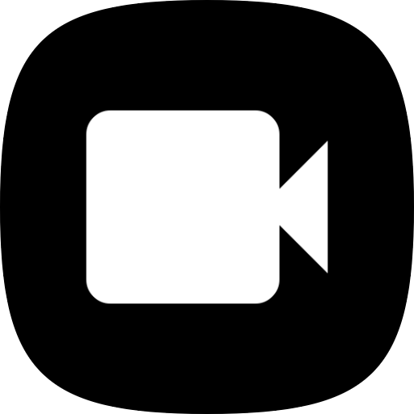
</p>

<h1 align="center">CapCraft for Android</h1>

<p align="center">
  <b>CapCraft-android is an open-source mobile video editor, built on the Rust engine of <a href="https://github.com/jub0t/concat">Concat</a>, a desktop video editor, and on a Kotlin/Jetpack Compose UI framework. Everything is made on the phone: no account, no cloud, nothing uploaded.</b><br>
  Many credits to the original maintainers, <a href="https://github.com/jub0t">jub0t</a> and the Concat contributors.
</p>

<p align="center">
  <a href="https://github.com/artcraft-android/capcraft-android/releases"></a>
  <a href="https://apps.obtainium.imranr.dev/redirect?r=obtainium://add/https://github.com/artcraft-android/capcraft-android"></a>
</p>

<p align="center">
  
  
  
  
  
  
</p>

<p align="center">
  <a href="#editing">Editing</a> ·
  <a href="#filters-effects-and-transitions">Filters, effects &amp; transitions</a> ·
  <a href="#text-and-stickers">Text &amp; stickers</a> ·
  <a href="#captions-and-sound">Captions &amp; sound</a> ·
  <a href="#export-and-home">Export &amp; Home</a> ·
  <a href="#planned-features">Planned features</a> ·
  <a href="#building-instructions">Building</a>
</p>

<br>

<p align="center">
  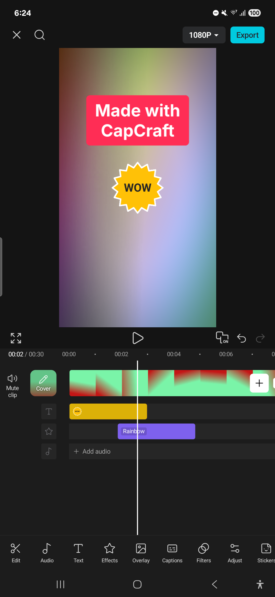
  <br>
  <sub>The editor: the preview, the transport row, a timeline with rows for text, stickers, effects and sound, and the tools.</sub>
</p>

<br>

## Editing

<table align="center">
<tr>
<td align="center">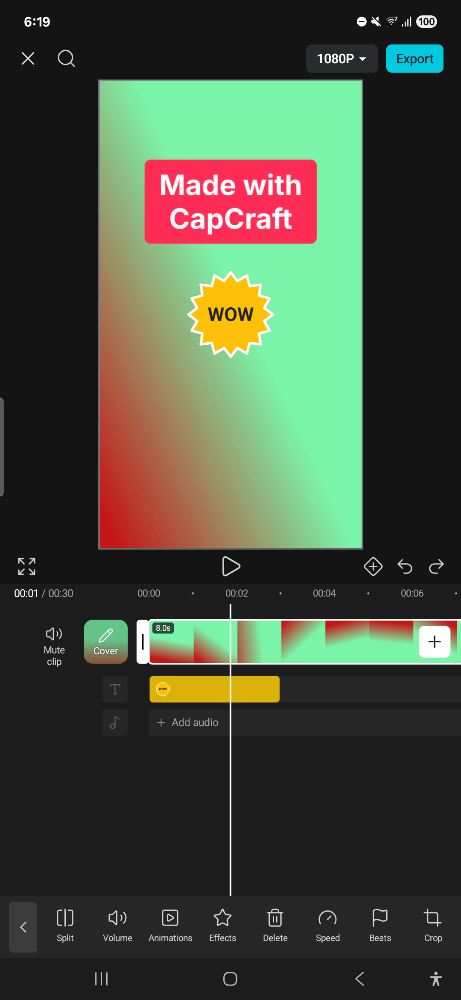</td>
<td align="center">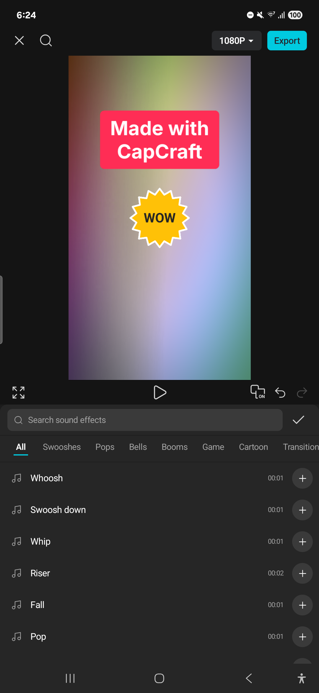</td>
</tr>
<tr>
<td align="center"><sub>A clip selected: split, volume, animations, speed, crop and more</sub></td>
<td align="center"><sub>Sound effects, made by the app</sub></td>
</tr>
</table>

<br>

## Filters, effects and transitions

<table align="center">
<tr>
<td align="center">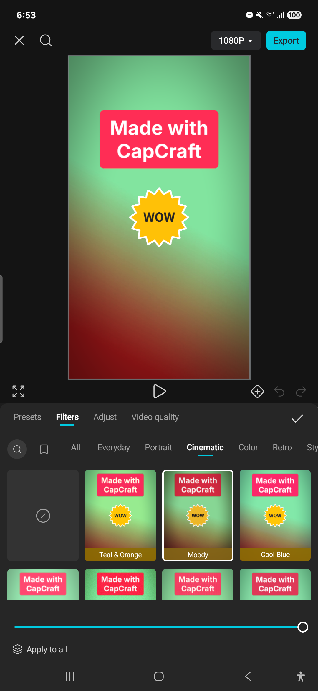</td>
<td align="center">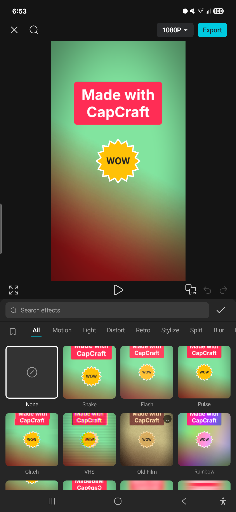</td>
</tr>
<tr>
<td align="center"><sub>80+ filters, previewed on the clip</sub></td>
<td align="center"><sub>Video effects, on a clip or on a row of their own</sub></td>
</tr>
</table>

<p align="center">
  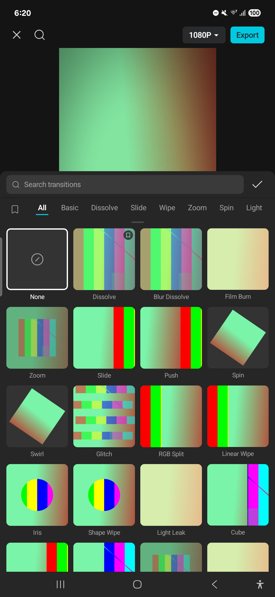
  <br>
  <sub>Transitions, every tile animated with your own clips.</sub>
</p>

<br>

## Text and stickers

<table align="center">
<tr>
<td align="center">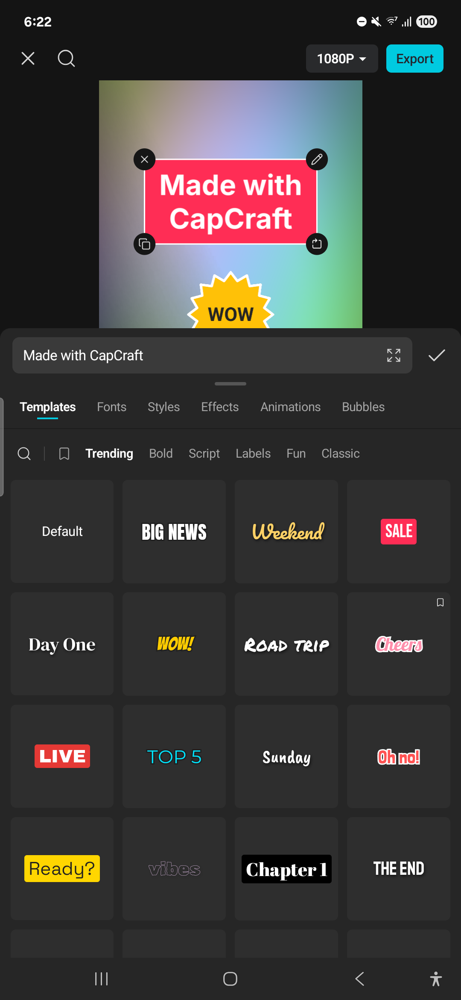</td>
<td align="center">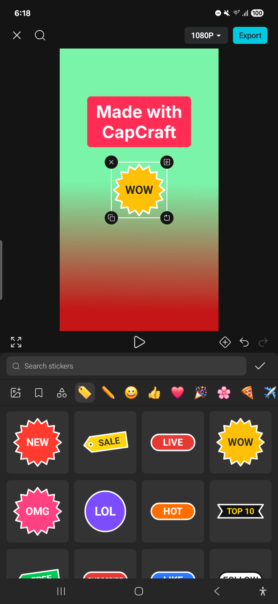</td>
</tr>
<tr>
<td align="center"><sub>Text: templates, fonts, styles, word art, animations and bubbles</sub></td>
<td align="center"><sub>Stickers, labels and doodles, drawn by the app</sub></td>
</tr>
</table>

<br>

## Captions and sound

<p align="center">
  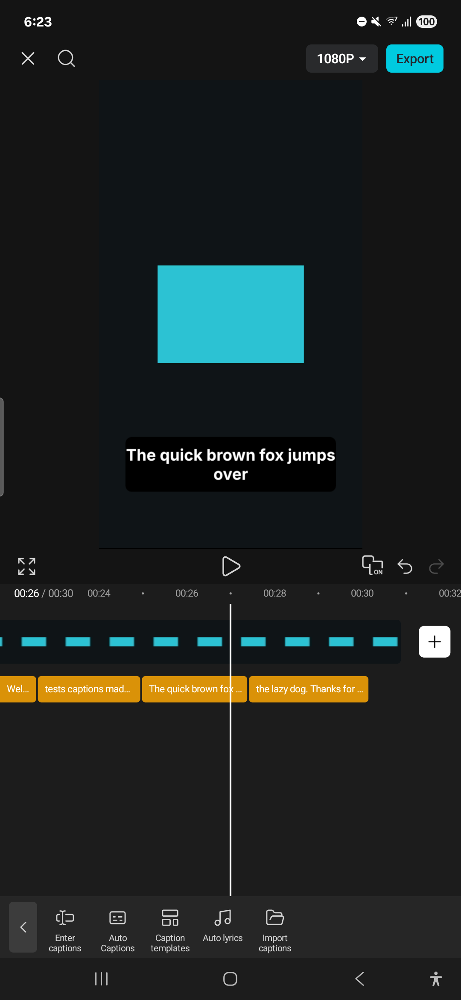
  <br>
  <sub>Captions, made on the phone from what is said.</sub>
</p>

<br>

## Export and Home

<table align="center">
<tr>
<td align="center">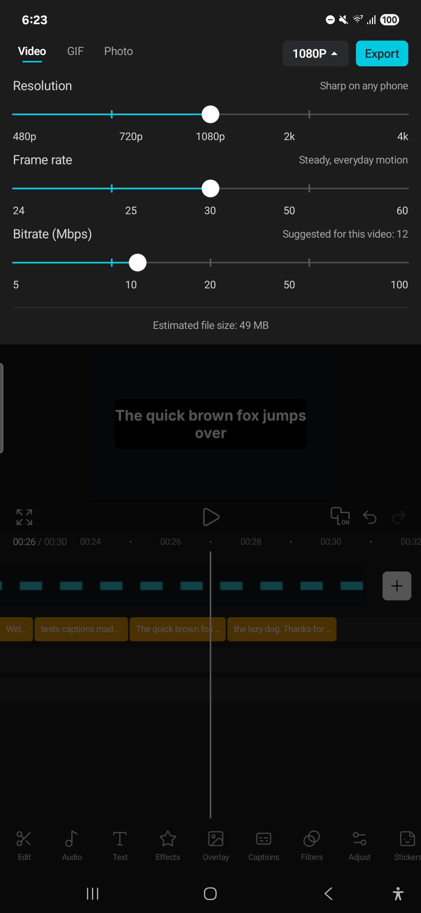</td>
<td align="center">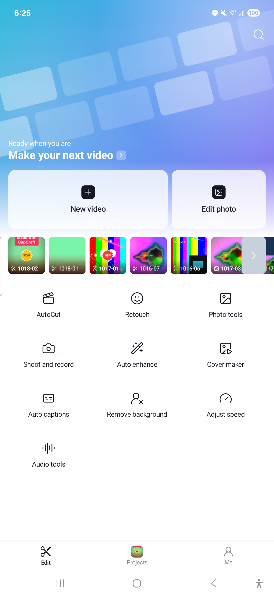</td>
</tr>
<tr>
<td align="center"><sub>Export at 480p to 4K, 24 to 60 fps, or as a GIF or photo</sub></td>
<td align="center"><sub>Home: start a video or a photo, then your projects</sub></td>
</tr>
</table>

<br>

## Planned features

CapCraft for Android is in beta.

| Area | Status |
|---|---|
| Projects from the phone's videos and photos, or shared to the app; autosave; rename, duplicate, delete | ✅ |
| The timeline: trim, move, split, delete, duplicate, replace, multi-select, undo and redo; pinch to zoom | ✅ |
| Speed and curves, freeze frame, reverse, volume and fades, crop, mask, chroma key, keyframes | ✅ |
| Overlays and layers with blend modes, opacity, transform and animations | ✅ |
| Filters, adjustments (HSL, curves, colour wheels), video effects, body effects and transitions | ✅ |
| Text: templates, fonts, styles, word art, bubbles, animations and text to speech | ✅ |
| Stickers, labels, shapes and drawing | ✅ |
| Captions made on the phone, typed captions, caption templates and imported subtitles | ✅ |
| Sound effects, voiceover, extract audio, voice effects, noise reduction and isolate voice | ✅ |
| Remove background (a model downloaded once, run on the phone) | ✅ |
| Aspect ratios, backgrounds, cover, AutoCut, collage | ✅ |
| Export at 480p to 4K, 24 to 60 fps, GIF and photo, saved to the gallery and shared | ✅ |
| A music library, downloadable effects and templates | ⬜ |
| Generative AI, cloud storage, accounts | 🚫 CapCraft is a local app |

<sub>✅ works today · 🚧 in progress · ⬜ not started · 🚫 not planned</sub>

<br>

## Building Instructions
*One Gradle command builds the app: it compiles the Rust engine with [cargo-ndk](https://github.com/bbqsrc/cargo-ndk) and generates the Kotlin bindings. FFmpeg and sherpa-onnx are fetched and built first, once.*

* Clone this repository
* Make sure you have at least 10 GB of free disk space
* In `src`, with `ANDROID_HOME` pointing at your Android SDK:
  ```
  scripts/ffmpeg-mobile.sh aarch64-linux-android
  scripts/sherpa-mobile.sh aarch64-linux-android
  eval "$(scripts/mobile-env.sh aarch64-linux-android)"
  ```
* then enter `src/crates/capcraft-android/android` and run `./gradlew assembleRelease`.

Build time dependencies:

<details>
  <summary>required tools</summary>

  ```
      Linux or macOS (on Windows, WSL)
      rustup (it installs the Rust release rust-toolchain.toml names)
      rustup target add aarch64-linux-android
      cargo install cargo-ndk --version 4.1.2 --locked
      Android SDK (API 37) and NDK 29.0.14206865
      JDK 17 or newer
      cmake, make, clang (libclang-dev), curl
  ```
</details>

*Builds are only tested in WSL Ubuntu on Windows 11.*

<br>

## License

[AGPL-3.0-or-later](LICENSE), as Concat's engine is (with its plugin exception, [LICENSE-EXCEPTIONS.md](LICENSE-EXCEPTIONS.md)). CapCraft for Android is not affiliated with, endorsed by or connected to ByteDance or CapCut.

<br>

## Misc info for myself

Try to use [semantic commit](https://kapeli.com/cheat_sheets/Semantic_Commits.docset/Contents/Resources/Documents/index)
messages. Use `feat:` / `fix:` / `chore:` / `docs:` / etc.
